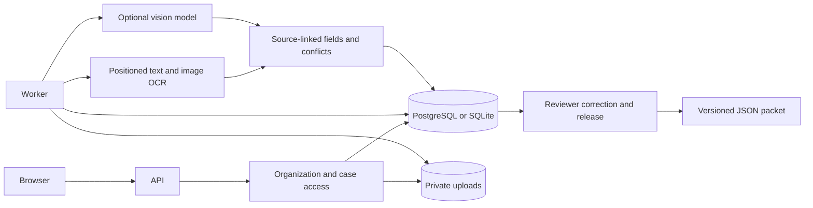

# Workbench architecture

## Persistence and access

`organizations` and `accounts` define the account boundary. Accounts use salted scrypt hashes. Sessions contain a signed account identifier and resolve active membership on each request. Cases record an organization and owner. `case_grants` adds access for named accounts within the organization. Case scope applies to lists, audit views, uploads, document sources and rendered pages, corrections, worksheets, and exports. Organization-level research reports are scoped independently.

The `cases` table stores case state, timeline entries, the latest calculation, and current release. `documents` stores case references, digests, processing status, and field evidence. `case_worksheets` stores supplementary parties and monetary inputs. `case_exports` preserves release snapshots. `benchmark_runs` stores paired evaluation reports. Uploaded bytes live outside the public frontend.

## Processing and review

The API validates file signatures and sizes and queues work with an opaque storage identifier. A single worker claims jobs with conditional database updates and requeues interrupted work on restart. The worker uses embedded PDF coordinates or word boxes from image OCR, then groups words on a line to recover fields split across columns. Evidence carries a page, source text, and a box when available. Conflicting normalized values in one document trigger abstention. Case checks also detect missing documents, name mismatches, expired identification, and cross-document field conflicts.

When the organization enables its configured vision endpoint, the worker sends a rendered image and available text to the model. Source-backed layout extraction corroborates values before they reach the review screen. A reviewer can correct document classification or field values and record exceptions. Release snapshots the reviewed state. Later edits invalidate the current release and preserve the audit trail.

## Research limits

The benchmark uses generated examples of four document types across seven conditions. The seed controls fictional names, and every pipeline receives the same fixtures. Reports distinguish unsupported emissions, coverage, conflict handling, and processing errors. Evidence accuracy verifies page attribution for correctly extracted fields. Human review workload is estimated from missing and flagged fields. The fixtures use known field labels and do not establish performance on diverse lender documents. Provider charges and real human review time are outside the benchmark.

The project is a local research and demonstration application. A production deployment requires organizational identity lifecycle controls, infrastructure isolation, retention policies, and operational monitoring.
